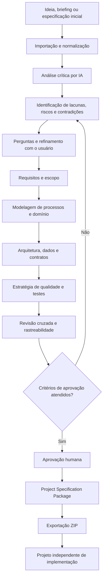
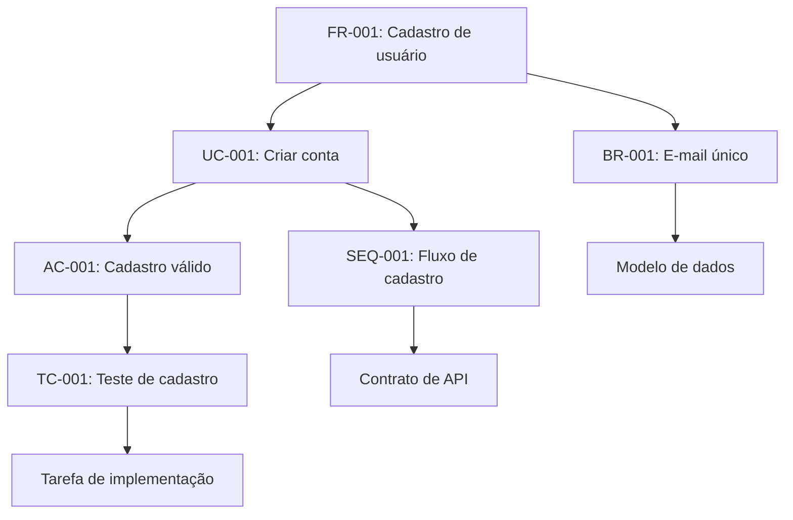
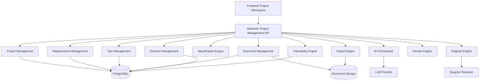

# lazy-mvp-project-generator

## Software Specification & Project Planning Platform

> Uma plataforma para transformar uma ideia, briefing ou especificação inicial em um pacote de documentação funcional e técnica, revisado, rastreável e pronto para ser utilizado por um projeto independente de implementação.

---

## 1. Visão do produto

O `lazy-mvp-project-generator` é uma plataforma de engenharia e especificação de software anterior à implementação.

Seu objetivo é resolver um problema recorrente no desenvolvimento de software: iniciar a programação sem compreender suficientemente o problema, sem delimitar o escopo, sem documentar os requisitos e sem amadurecer as decisões necessárias para orientar a implementação.

A plataforma não tem como objetivo principal gerar código. Ela deve organizar o processo de descoberta, análise, refinamento, documentação, modelagem, revisão e aprovação de um projeto.

O produto será dividido em dois ambientes independentes:

1. **Project Discovery & Specification:** recebe a ideia inicial, analisa a especificação, identifica lacunas, conduz o refinamento, documenta requisitos, processos, arquitetura, dados, decisões e testes.
2. **Project Implementation:** projeto separado, fora do escopo desta plataforma, que recebe o pacote de especificações aprovado e realiza a implementação do software.

A comunicação entre os dois ambientes ocorrerá por meio de um pacote exportável, versionado e autossuficiente.

### 1.1. Princípios fundamentais

- **Requirements First:** compreender e documentar o problema antes de tomar decisões de implementação.
- **Documentation as Code:** manter documentação versionada, estruturada e validável.
- **Progressive Documentation:** produzir os artefatos necessários de acordo com a complexidade do projeto, evitando burocracia.
- **Human Approval:** decisões relevantes e mudanças de escopo precisam de aprovação explícita.
- **Traceability:** requisitos, regras, fluxos, decisões, diagramas, testes e tarefas devem ser relacionados.
- **Project Isolation:** cada projeto possui contexto, documentos, tarefas, histórico e decisões independentes.
- **Change-Friendly:** mudanças futuras devem preservar histórico e permitir análise de impacto.
- **No Silent Assumptions:** sugestões da IA não podem ser tratadas como decisões confirmadas sem aprovação.

---

## 2. Problema que o produto pretende resolver

Projetos frequentemente começam com descrições vagas e incompletas. Durante o desenvolvimento, surgem dúvidas sobre regras de negócio, comportamentos, permissões, exceções, integrações e limites do escopo.

Isso causa:

- Retrabalho por falta de definição.
- Implementações baseadas em suposições.
- Requisitos contraditórios ou ambíguos.
- Ausência de critérios objetivos de aceitação.
- Arquitetura escolhida sem contexto suficiente.
- Diagramas e documentos inconsistentes entre si.
- Dificuldade para estimar e dividir o trabalho.
- Mudanças de escopo sem análise de impacto.
- Dificuldade de transferir o conhecimento para outro desenvolvedor ou agente de programação.

A plataforma deve transformar uma especificação inicial em um conjunto de artefatos coerentes, permitindo que o desenvolvimento comece somente depois de um nível de maturidade previamente definido.

---

## 3. Público e forma de utilização

O usuário pode ser:

- Um cliente com uma ideia de produto.
- Um analista de negócio.
- Um Product Owner.
- Um desenvolvedor que deseja estruturar um projeto pessoal.
- Uma equipe que precisa padronizar a fase anterior à implementação.
- Um usuário que utiliza outra IA para produzir um briefing inicial.

O cliente não precisa conhecer conceitos técnicos como DDD, UML, REST, BPMN ou arquitetura hexagonal. A plataforma deve traduzir necessidades de negócio em especificações compreensíveis e, quando necessário, em artefatos técnicos.

O usuário poderá fornecer:

- Um formulário guiado.
- Um documento Markdown.
- Uma especificação estruturada produzida por outra IA.
- Documentos complementares.
- Respostas a perguntas feitas durante o processo de refinamento.

---

## 4. Fluxo geral do produto



O fluxo deve ser iterativo. Uma decisão arquitetural pode exigir revisão de requisitos não funcionais; uma regra de negócio descoberta durante a modelagem pode alterar casos de uso e modelo de domínio.

A plataforma não deve exigir que o usuário conclua todas as etapas em uma única sessão.

---

## 5. Entrada inicial: Project Brief

A entrada inicial deve possuir um formato padronizado, mas flexível. O usuário poderá preencher um formulário ou importar um Markdown produzido por outra ferramenta ou IA.

### 5.1. Estrutura mínima do briefing

| Seção | Conteúdo esperado |
|---|---|
| Project Overview | Nome, descrição e objetivo geral |
| Problem Statement | Problema que o projeto pretende resolver |
| Target Audience | Público-alvo e perfis de usuários |
| Business Context | Contexto do negócio e operação |
| Main Features | Funcionalidades desejadas |
| User Expectations | Expectativas dos usuários |
| Business Rules | Regras de negócio já conhecidas |
| Integrations | Sistemas e serviços externos envolvidos |
| Constraints | Restrições técnicas, operacionais ou legais conhecidas |
| Success Criteria | Como medir o sucesso |
| Out of Scope | O que não deve fazer parte do projeto |
| Open Questions | Dúvidas e pontos ainda não definidos |

### 5.2. Modelo de arquivo inicial

```markdown
# Project Brief

## 1. Project Overview
- Project name:
- Short description:
- Main objective:

## 2. Problem Statement
- What problem should be solved?
- How is this problem currently handled?
- What are the main difficulties?

## 3. Target Audience
- Primary users:
- Secondary users:
- Stakeholders:

## 4. Business Context
- Business domain:
- Operational context:
- Existing systems or processes:

## 5. Main Features
- Feature 1:
- Feature 2:
- Feature 3:

## 6. User Expectations
- Expected outcomes:
- Important user interactions:

## 7. Business Rules
- Known rules:
- Restrictions:
- Exceptions:

## 8. Integrations
- External systems:
- APIs:
- Data sources:

## 9. Constraints
- Technical:
- Operational:
- Legal or regulatory:
- Budget or time:

## 10. Success Criteria
- Expected results:
- Success metrics:

## 11. Out of Scope
- Explicit exclusions:

## 12. Open Questions
- Questions:
- Unknown information:
```

Campos podem permanecer sem resposta. A ausência de informação deve gerar uma lacuna para análise, não uma suposição automática.

---

## 6. Análise crítica e refinamento por IA

A análise crítica da especificação inicial é uma das funcionalidades centrais do produto.

A IA não deve apenas aceitar o briefing e gerar documentos. Deve atuar como analista crítico, questionando informações insuficientes e apontando problemas.

### 6.1. Categorias de análise

- Informações ausentes.
- Requisitos ambíguos.
- Requisitos contraditórios.
- Regras de negócio incompletas.
- Escopo excessivamente amplo.
- Funcionalidades sem justificativa clara.
- Casos de uso sem tratamento de exceções.
- Restrições não consideradas.
- Dependências externas.
- Riscos técnicos e operacionais.
- Requisitos não funcionais sem métricas.
- Critérios de sucesso ausentes ou subjetivos.

### 6.2. Classificação das informações

Cada informação relevante deve possuir uma classificação explícita:

| Status | Significado |
|---|---|
| `confirmed` | Confirmada pelo usuário ou stakeholder autorizado |
| `proposed` | Sugestão da IA aguardando aprovação |
| `assumed` | Premissa provisória, com justificativa e responsável |
| `unknown` | Informação ainda não definida |
| `rejected` | Proposta analisada e rejeitada |
| `superseded` | Informação substituída por uma decisão posterior |

A IA não pode decidir silenciosamente que a aplicação utilizará PostgreSQL, JWT, microsserviços ou determinada tecnologia e transformar essa escolha em requisito aprovado.

Toda decisão relevante deve registrar origem, justificativa, status e, quando aplicável, responsável pela aprovação.

### 6.3. Ciclo iterativo de refinamento

1. A IA analisa os documentos existentes.
2. Identifica os problemas mais importantes.
3. Prioriza lacunas por impacto e risco.
4. Apresenta um conjunto pequeno de perguntas relacionadas.
5. O usuário responde, rejeita ou aprova uma proposta.
6. O sistema atualiza os dados e documentos afetados.
7. A IA verifica se as lacunas foram resolvidas.
8. O ciclo continua até atingir os critérios de maturidade e aprovação.

As perguntas devem ser agrupadas por assunto e evitar entrevistas excessivamente longas.

### 6.4. Indicador de maturidade

A plataforma pode apresentar um indicador de completude por dimensão, por exemplo:

- Discovery.
- Escopo.
- Requisitos.
- Regras de negócio.
- Fluxos.
- Domínio.
- Arquitetura.
- Dados.
- Interfaces.
- Qualidade e testes.

O indicador deve ser explicável: mostrar quais critérios foram atendidos e quais faltam. Não deve ser apresentado como uma medida objetiva de qualidade do software nem substituir revisão humana.

---

## 7. Etapas e entregáveis da especificação

A plataforma deve organizar o trabalho em etapas com entradas, atividades, artefatos, tarefas e critérios de conclusão.

### 7.1. Discovery e análise de negócio

Objetivo: compreender o problema, os envolvidos, o contexto e os resultados esperados.

Atividades:

- Stakeholder Analysis.
- Entrevistas e elicitação.
- Problem Statement.
- Five Whys e análise de causa raiz.
- Jobs To Be Done, quando aplicável.
- User Journey Mapping.
- Business Model Canvas, quando aplicável.
- Assumptions Mapping.
- Identificação de riscos iniciais.

Entregáveis:

```text
00-discovery/
├── discovery-brief.md
├── problem-statement.md
├── stakeholder-analysis.md
├── interview-notes.md
├── business-context.md
├── user-personas.md
├── user-journey.md
├── assumptions-and-risks.md
└── discovery-summary.md
```

Referências:

- IIBA BABOK: https://www.iiba.org/career-resources/a-business-analysis-professionals-foundation-for-success/babok/
- ISO/IEC/IEEE 29148: https://www.iso.org/standard/72089.html
- Scrum Guide: https://scrumguides.org/

### 7.2. Definição do produto e do MVP

Objetivo: delimitar o que será construído e o que ficará fora da primeira versão.

Atividades:

- Product Vision.
- Definição de personas.
- User Story Mapping.
- Priorização MoSCoW.
- Impact Mapping, quando aplicável.
- Definição de hipóteses.
- Definição de métricas de sucesso.
- Identificação de funcionalidades fora do escopo.

Entregáveis:

```text
01-product/
├── product-vision.md
├── mvp-scope.md
├── user-personas.md
├── success-metrics.md
├── assumptions.md
└── out-of-scope.md
```

Referências:

- Scrum Guide: https://scrumguides.org/
- The Lean Startup: https://leanstartup.co/
- MoSCoW: https://www.productplan.com/glossary/moscow-prioritization/
- Atlassian — Requirements: https://www.atlassian.com/agile/product-management/requirements

### 7.3. Engenharia de requisitos

Objetivo: documentar de forma verificável o comportamento esperado do sistema e suas restrições.

Tipos de informação:

- Requisitos funcionais (FR).
- Requisitos não funcionais (NFR).
- Regras de negócio (BR).
- Critérios de aceitação (AC).
- Restrições técnicas e operacionais.
- Requisitos de interface.
- Requisitos de integração.
- Requisitos de segurança e privacidade.

Exemplo:

```text
FR-001
Título: Cadastro de usuário
Descrição: O sistema deve permitir que visitantes criem uma conta.
Origem: Project Brief
Prioridade: MUST
Status: confirmed

BR-001
Título: Unicidade do e-mail
Descrição: Um endereço de e-mail não pode estar associado a duas contas ativas.

AC-001
Dado que um e-mail já está cadastrado,
quando o usuário tentar criar uma nova conta com esse e-mail,
então o sistema deve rejeitar a operação e informar o motivo.

NFR-001
Categoria: Performance
Requisito: 95% das consultas devem responder em até 500 ms.
Condição: Carga de até 100 requisições simultâneas.
Validação: Teste de carga automatizado.
```

Entregáveis:

```text
02-requirements/
├── functional-requirements.md
├── non-functional-requirements.md
├── business-rules.md
├── use-cases.md
├── user-stories.md
├── acceptance-criteria.md
└── constraints.md
```

Referências:

- ISO/IEC/IEEE 29148: https://www.iso.org/standard/72089.html
- IIBA BABOK: https://www.iiba.org/
- Gherkin: https://cucumber.io/docs/gherkin/reference/

### 7.4. Modelagem de processos e fluxos

Objetivo: representar os processos de negócio e os comportamentos esperados da aplicação.

Artefatos possíveis:

- BPMN para processos de negócio.
- Use Case Diagram para atores e casos de uso.
- Activity Diagram para fluxos de atividades.
- Sequence Diagram para interações entre componentes.
- State Machine Diagram para ciclo de vida de entidades.
- User Journey para experiência do usuário.
- Fluxos principais, alternativos e de exceção.

Entregáveis:

```text
03-processes/
├── user-flows.md
├── business-processes.md
├── use-cases/
└── diagrams/
```

Referências:

- OMG UML: https://www.omg.org/spec/UML
- OMG BPMN: https://www.omg.org/spec/BPMN
- Mermaid: https://mermaid.js.org/
- Gherkin: https://cucumber.io/docs/gherkin/reference/

### 7.5. Modelagem de domínio

Objetivo: identificar conceitos, entidades e regras centrais do negócio, evitando que a estrutura técnica seja definida sem compreensão do domínio.

Conceitos:

- Domain Model.
- Entity.
- Value Object.
- Aggregate e Aggregate Root.
- Domain Service.
- Repository.
- Bounded Context.
- Ubiquitous Language.
- Context Map, quando necessário.

Entregáveis:

```text
04-domain/
├── domain-model.md
├── ubiquitous-language.md
├── bounded-contexts.md
└── diagrams/
```

Referências:

- Domain-Driven Design — Eric Evans: https://www.domainlanguage.com/ddd/
- Martin Fowler — DDD: https://martinfowler.com/bliki/DomainDrivenDesign.html
- Patterns of Enterprise Application Architecture: https://martinfowler.com/eaaCatalog/

Não é necessário produzir um diagrama de classes completo para todo MVP. Os diagramas devem representar abstrações relevantes para compreender o domínio.

### 7.6. Arquitetura de software

Objetivo: documentar a solução técnica em nível suficiente para orientar a implementação posterior.

Artefatos:

- Contexto do sistema.
- Containers e aplicações.
- Componentes e responsabilidades.
- Integrações e dependências.
- Visão de implantação, quando necessária.
- Requisitos de qualidade arquitetural.
- Decisões arquiteturais (ADRs).
- Restrições tecnológicas, quando confirmadas.

Referências prioritárias:

- arc42: https://docs.arc42.org/
- arc42 template: https://github.com/arc42/arc42-template
- C4 Model: https://c4model.com/
- C4 diagrams: https://c4model.com/diagrams
- Architecture Decision Records: https://adr.github.io/
- ISO/IEC/IEEE 42010: https://www.iso.org/standard/50508.html
- Martin Fowler — Architecture: https://martinfowler.com/architecture/

O C4 Model organiza a representação em quatro níveis:

1. System Context.
2. Container.
3. Component.
4. Code.

Para projetos menores, os níveis de contexto e containers podem ser suficientes. Os demais devem ser produzidos quando agregarem valor.

#### Architecture Decision Records (ADR)

Decisões importantes devem ser registradas com contexto, alternativas, decisão e consequências.

Exemplo:

```markdown
# ADR-001: Escolha do banco de dados

## Status
Proposed

## Context
A aplicação precisa armazenar dados relacionais e transacionais.

## Decision
A definir após análise das necessidades e restrições.

## Alternatives
- PostgreSQL
- MySQL
- MongoDB

## Consequences
A documentar após a decisão.
```

Entregáveis:

```text
05-architecture/
├── architecture-overview.md
├── architecture-context.md
├── architecture-decisions/
├── c4/
└── uml/
```

### 7.7. Modelagem de dados

Objetivo: documentar os dados necessários ao domínio e sua representação persistente.

Níveis:

| Nível | Conteúdo |
|---|---|
| Conceitual | Entidades e relacionamentos do negócio |
| Lógico | Atributos, cardinalidade, chaves e normalização |
| Físico | Tabelas, tipos, índices, constraints e detalhes do banco |

O dicionário de dados deve documentar campos, significados, tipos, obrigatoriedade, regras e origem.

Entregáveis:

```text
06-database/
├── conceptual-model.md
├── logical-model.md
├── physical-model.md
├── er-diagram.mmd
├── schema.dbml
└── data-dictionary.md
```

Referências:

- PostgreSQL Documentation: https://www.postgresql.org/docs/
- DBML: https://www.dbml.org/
- Mermaid ER Diagram: https://mermaid.js.org/syntax/entityRelationshipDiagram.html
- OMG UML: https://www.omg.org/spec/UML

### 7.8. APIs e contratos de integração

Objetivo: documentar interfaces e contratos entre o sistema e outros componentes ou serviços.

Para APIs HTTP, adotar OpenAPI como formato preferencial.

A especificação deve incluir:

- Endpoints e métodos.
- Parâmetros.
- Request e Response.
- Códigos de status.
- Schemas.
- Autenticação e autorização.
- Exemplos.
- Erros esperados.
- Regras de compatibilidade.

Para outros estilos:

- AsyncAPI para comunicação orientada a eventos.
- GraphQL Schema para APIs GraphQL.

Referências:

- OpenAPI: https://spec.openapis.org/oas/latest.html
- AsyncAPI: https://www.asyncapi.com/docs/reference/specification/latest
- GraphQL Schema: https://graphql.org/learn/schema/

Entregáveis:

```text
07-interfaces/
├── api-specification.yaml
├── integrations.md
├── events.md
└── contracts/
```

### 7.9. Qualidade, testes e segurança

Objetivo: definir como o produto será validado, quais comportamentos precisam ser testados e quais requisitos de segurança e qualidade devem ser atendidos.

Categorias de teste:

- Unitários.
- Integração.
- Componentes.
- Contratos.
- End-to-end.
- Aceitação.
- Performance.
- Segurança.

Também considerar:

- Test Pyramid.
- Particionamento de equivalência.
- Análise de valor limite.
- Tabelas de decisão.
- Transição de estados.
- Testes baseados em risco.
- Threat Modeling.
- STRIDE, quando aplicável.

Referências:

- ISTQB: https://www.istqb.org/
- OWASP ASVS: https://owasp.org/www-project-asvs/
- NIST SSDF: https://csrc.nist.gov/pubs/sp/800/218/final
- Test Pyramid — Martin Fowler: https://martinfowler.com/articles/practical-test-pyramid.html
- Gherkin: https://cucumber.io/docs/gherkin/reference/
- Microsoft Threat Modeling: https://learn.microsoft.com/en-us/azure/security/develop/threat-modeling-tool

Entregáveis:

```text
08-quality/
├── test-strategy.md
├── test-scenarios.md
├── security-requirements.md
├── quality-criteria.md
└── risk-assessment.md
```

### 7.10. Requisitos não funcionais e qualidade do produto

A ISO/IEC 25010:2023 é uma referência para estruturar características e subcaracterísticas de qualidade do produto.

Referência: https://www.iso.org/standard/78176.html

A análise deve considerar, conforme o contexto:

- Performance.
- Segurança.
- Confiabilidade.
- Manutenibilidade.
- Compatibilidade.
- Usabilidade.
- Flexibilidade.
- Segurança operacional.
- Escalabilidade, quando aplicável.

Requisitos devem ser mensuráveis sempre que possível. Evitar descrições vagas como “o sistema deve ser rápido” ou “o sistema deve ser seguro”.

### 7.11. Planejamento da implementação

Esta etapa não implementa o sistema. Ela transforma a especificação aprovada em unidades de trabalho para o projeto posterior.

Entregáveis:

```text
09-planning/
├── implementation-epics.md
├── implementation-backlog.md
├── implementation-specs/
├── dependency-map.md
├── milestones.md
└── traceability-matrix.csv
```

As tarefas devem conter:

- Identificador.
- Objetivo.
- Descrição.
- Requisitos relacionados.
- Dependências.
- Critérios de aceitação.
- Referências aos documentos.
- Prioridade.
- Observações para implementação.

O backlog de implementação é exportado como especificação para o segundo projeto. Não deve ser confundido com o Kanban de documentação desta plataforma.

---

## 8. Kanban de documentação

Cada projeto terá um quadro Kanban próprio para acompanhar o trabalho de análise e documentação.

Colunas iniciais sugeridas:

- Backlog.
- Ready.
- In Progress.
- Review.
- Blocked.
- Done.

Tipos de tarefa:

| Tipo | Exemplo |
|---|---|
| Discovery | Investigar comportamento esperado |
| Requirement | Definir requisito funcional |
| Business Rule | Especificar regra de negócio |
| Modeling | Criar diagrama de domínio |
| Architecture | Definir abordagem arquitetural |
| Database | Elaborar modelo ER |
| Review | Revisar documentação |
| Decision | Aprovar decisão pendente |
| Validation | Validar consistência entre artefatos |

Cada tarefa deve possuir:

- ID.
- Título e descrição.
- Tipo.
- Prioridade.
- Status.
- Responsável (usuário ou agente).
- Documento ou artefato relacionado.
- Dependências.
- Critérios de conclusão.
- Histórico de alterações.

Uma tarefa não será considerada concluída apenas porque a IA produziu um documento. Deve atender aos critérios de conclusão e passar por aprovação humana quando necessário.

O Kanban acompanha exclusivamente o processo de especificação e documentação. Atividades de implementação pertencem ao projeto posterior.

---

## 9. Workspaces e isolamento entre projetos

A aplicação deve organizar os dados por projeto.

Cada projeto terá seu próprio:

- Briefing e contexto.
- Requisitos.
- Documentos.
- Diagramas.
- Tarefas.
- Revisões.
- Decisões.
- Histórico.
- Versões.
- Aprovações.
- Pacotes exportados.

Nenhum agente deve utilizar informações de outro projeto sem uma ação explícita de importação ou compartilhamento.

### 9.1. Áreas da interface

| Área | Responsabilidade |
|---|---|
| Dashboard | Estado geral e progresso da especificação |
| Discovery | Entrada e refinamento da ideia |
| Requirements | Requisitos e regras de negócio |
| Kanban | Tarefas de documentação e análise |
| Documents | Documentos do projeto |
| Diagrams | Diagramas e modelos visuais |
| ADRs | Decisões arquiteturais |
| Specifications | Specs para implementação |
| Reviews | Críticas e validações da IA |
| History | Histórico de alterações |
| Export | Geração do pacote ZIP |

### 9.2. Dashboard do projeto

Deve apresentar:

- Etapa atual.
- Progresso por disciplina.
- Tarefas pendentes.
- Documentos em revisão.
- Lacunas críticas.
- Decisões aguardando aprovação.
- Riscos abertos.
- Últimas alterações.
- Estado de prontidão para exportação.

---

## 10. Gestão de mudanças e evolução da especificação

A especificação não pode ser tratada como um documento estático.

A plataforma deve possuir um mecanismo de Change Request e análise de impacto.

Exemplo: o cliente solicita suporte a múltiplas empresas depois de aprovar o MVP.

Possíveis impactos:

- Requisitos funcionais: usuários e organizações.
- Requisitos não funcionais: isolamento de dados.
- Regras de negócio: permissões por organização.
- Modelo de domínio: entidade Organization.
- Banco de dados: relacionamentos e estratégia de isolamento.
- Arquitetura: estratégia multi-tenant.
- API: contexto da organização.
- Testes: isolamento e autorização.

Fluxo de mudança:

1. Registrar a solicitação.
2. Identificar requisitos e documentos afetados.
3. Analisar impactos no escopo, riscos e dependências.
4. Gerar tarefas de revisão.
5. Solicitar aprovação.
6. Atualizar os artefatos.
7. Criar nova versão da especificação.
8. Preservar o histórico da versão anterior.

Conceitos relacionados:

- Change Request.
- Impact Analysis.
- Requirement Traceability.
- Version History.
- ADR Superseding.
- Changelog.
- Approval Records.

Uma alteração aprovada não deve apagar a decisão anterior. Deve registrar o que mudou, quando, por quem e por qual motivo.

---

## 11. Matriz de rastreabilidade

A rastreabilidade deve conectar os artefatos ao longo de todo o processo.

Exemplo:



A plataforma deve responder:

- Quais requisitos ainda não possuem critérios de aceitação?
- Quais requisitos não possuem cenários de teste?
- Quais funcionalidades não possuem fluxo documentado?
- Quais decisões arquiteturais estão relacionadas a determinado requisito?
- Quais documentos serão afetados por uma alteração?
- Quais tarefas de implementação dependem de um requisito?

A rastreabilidade deve ser armazenada em formato estruturado e também exportada em formato legível, como CSV ou Markdown.

---

## 12. Revisão técnica e critérios de aprovação

A plataforma deve possuir uma etapa de revisão antes de permitir que a especificação seja considerada pronta.

### 12.1. Verificações

- Requisitos contraditórios.
- Requisitos ambíguos.
- Requisitos sem critérios de aceitação.
- Regras de negócio incompletas.
- Fluxos sem exceções relevantes.
- Entidades sem justificativa.
- Relacionamentos inconsistentes.
- Decisões arquiteturais sem justificativa.
- Requisitos não funcionais sem métricas.
- Ausência de estratégia de testes.
- Artefatos incompatíveis entre si.
- Requisitos sem rastreabilidade.
- Pendências críticas não resolvidas.

### 12.2. Definition of Ready

Uma especificação ou funcionalidade pode ser considerada pronta para planejamento de implementação quando:

- O objetivo está compreendido.
- O requisito possui identificador.
- As regras de negócio relevantes estão documentadas.
- Os critérios de aceitação estão definidos.
- O fluxo principal está documentado.
- Exceções relevantes foram consideradas.
- Dependências foram identificadas.
- As dúvidas críticas foram resolvidas ou explicitamente aceitas como pendências.

### 12.3. Definition of Done da documentação

Um artefato documental pode ser considerado concluído quando:

- Possui responsável e status.
- Foi validado contra seu schema, quando aplicável.
- Possui referências e vínculos necessários.
- Não contém lacunas críticas conhecidas.
- Passou pela revisão prevista.
- Está versionado.
- Foi aprovado quando a aprovação é obrigatória.

### 12.4. Gates do processo

| Gate | Etapa | Condição de avanço |
|---|---|---|
| Gate 1 | Discovery | Problema e stakeholders compreendidos |
| Gate 2 | Product Definition | Escopo e MVP aprovados |
| Gate 3 | System Analysis | Comportamentos e regras definidos |
| Gate 4 | Technical Design | Solução técnica revisada |
| Gate 5 | Quality Engineering | Estratégia de validação definida |
| Gate 6 | Implementation Planning | Backlog e especificações prontos |

Cada Gate pode ter três resultados:

- `approved`: pode avançar.
- `needs_revision`: precisa corrigir artefatos.
- `blocked`: faltam informações essenciais.

A aprovação deve ser explícita e registrada. Para projetos pessoais, o próprio usuário pode aprovar.

---

## 13. Utilização de IA

A IA deve assumir responsabilidades especializadas, mas os papéis não precisam necessariamente ser agentes autônomos independentes.

Uma primeira versão pode utilizar um orquestrador com prompts especializados, ferramentas de validação e etapas bem definidas.

| Papel | Responsabilidade |
|---|---|
| Discovery Analyst | Compreender a ideia e conduzir perguntas |
| Product Analyst | Definir MVP, escopo e prioridades |
| Requirements Engineer | Elaborar e revisar requisitos |
| Business Analyst | Identificar processos e regras de negócio |
| Domain Analyst | Identificar entidades e conceitos |
| Software Architect | Propor arquitetura e registrar ADRs |
| Database Designer | Elaborar modelos de dados |
| QA Engineer | Criar cenários e estratégias de teste |
| Technical Reviewer | Identificar inconsistências entre documentos |

### 13.1. Separação entre geração e revisão

Recomendação:

1. Um papel especializado produz o artefato.
2. Um revisor diferente analisa ambiguidades, contradições e lacunas.
3. O sistema registra os achados.
4. O usuário ou agente responsável revisa o documento.
5. O artefato passa por validação determinística.
6. A aprovação humana é solicitada quando necessária.

A mesma IA não deve simplesmente declarar que seu próprio trabalho está correto.

### 13.2. Dados estruturados e documentos

Além de Markdown, utilizar JSON ou YAML como representação estruturada.

Exemplo de requisito:

```yaml
id: FR-001
title: User Registration
description: >
  The system must allow users to
  create an account.

priority: MUST
status: confirmed

actor:
  - visitor

acceptance_criteria:
  - id: AC-001
    description: >
      The system must reject an
      already registered email.

related_rules:
  - BR-001

related_tests:
  - TC-001
```

O Markdown será uma representação legível. Os dados estruturados permitirão validação, automação, geração de diagramas e rastreabilidade.

### 13.3. Regras para os agentes

- Não inventar informações ausentes.
- Diferenciar fatos, propostas, premissas e desconhecidos.
- Citar a origem das informações relevantes.
- Não alterar decisões aprovadas sem registrar uma solicitação de mudança.
- Não aprovar automaticamente o próprio trabalho.
- Não misturar contexto de projetos.
- Não gerar artefatos incompatíveis com os schemas.
- Informar incertezas e limitações.
- Solicitar esclarecimentos quando uma decisão afetar significativamente o escopo.

---

## 14. Estrutura proposta do repositório

Estrutura inicial do repositório que contém a metodologia e os templates da própria fábrica:

```text
lazy-mvp-project-generator/
│
├── README.md
├── CONTRIBUTING.md
├── LICENSE
│
├── methodology/
│   ├── development-lifecycle.md
│   ├── project-gates.md
│   ├── documentation-principles.md
│   ├── change-management.md
│   └── quality-checklist.md
│
├── references/
│   ├── requirements-engineering.md
│   ├── business-analysis.md
│   ├── mvp-methodology.md
│   ├── software-architecture.md
│   ├── domain-driven-design.md
│   ├── database-design.md
│   ├── api-design.md
│   └── software-testing.md
│
├── templates/
│   ├── 00-discovery/
│   ├── 01-product/
│   ├── 02-requirements/
│   ├── 03-processes/
│   ├── 04-domain/
│   ├── 05-architecture/
│   ├── 06-database/
│   ├── 07-interfaces/
│   ├── 08-quality/
│   ├── 09-planning/
│   └── 10-reviews/
│
├── diagrams/
│   ├── architecture/
│   ├── uml/
│   ├── bpmn/
│   ├── database/
│   └── flows/
│
├── checklists/
│   ├── discovery-review.md
│   ├── requirements-review.md
│   ├── architecture-review.md
│   ├── database-review.md
│   ├── testing-review.md
│   └── export-readiness.md
│
├── prompts/
│   ├── discovery/
│   ├── requirements/
│   ├── architecture/
│   ├── database/
│   ├── testing/
│   └── reviewers/
│
├── schemas/
│   ├── project.schema.json
│   ├── requirement.schema.json
│   ├── use-case.schema.json
│   ├── task.schema.json
│   ├── decision.schema.json
│   └── test-case.schema.json
│
├── examples/
│   └── sample-project/
│
└── docs/
    ├── product-vision.md
    ├── product-scope.md
    ├── functional-requirements.md
    ├── non-functional-requirements.md
    ├── user-flows.md
    ├── domain-model.md
    ├── architecture.md
    ├── database-design.md
    └── acceptance-criteria.md
```

A pasta `references/` deve guardar conceitos, orientações e links para materiais externos. A pasta `templates/` deve conter documentos que serão preenchidos em cada projeto. A pasta `docs/` documenta a própria plataforma.

---

## 15. Arquitetura conceitual da plataforma

A primeira implementação deve privilegiar um monólito modular, evitando a complexidade prematura de microsserviços.

Módulos conceituais:

| Módulo | Responsabilidade |
|---|---|
| Project Management | Projetos, workspaces e isolamento |
| Requirements Management | Requisitos, regras e critérios |
| Task Management | Kanban e tarefas documentais |
| Document Management | Documentos e versões |
| Specification Engine | Templates, schemas e validações |
| AI Orchestrator | Análise, crítica e refinamento |
| Diagram Engine | Geração e validação de diagramas |
| Decision Management | ADRs e aprovações |
| Traceability Engine | Relações entre artefatos |
| Review Engine | Revisões e achados |
| Export Engine | Manifesto, pacote ZIP e integridade |

### 15.1. Arquitetura conceitual



### 15.2. Fonte de verdade dos artefatos

O conteúdo dos documentos deve ser separado de suas representações.

Por exemplo, um requisito deve existir como entidade estruturada. O Markdown é uma representação legível desse requisito, não necessariamente sua única fonte de dados.

Isso permite:

- Editar requisitos pela interface.
- Gerar Markdown automaticamente.
- Alimentar diagramas.
- Construir a matriz de rastreabilidade.
- Validar referências.
- Identificar impactos de alterações.

A plataforma deve definir claramente quais dados são canônicos e como as edições nos documentos renderizados são sincronizadas de volta aos dados estruturados. Não permitir divergência silenciosa entre versões.

---

## 16. Exportação: Project Specification Package (PSP)

O resultado final do processo será um pacote independente, destinado a ser consumido por um segundo projeto responsável pela implementação.

O projeto de implementação não deve depender do banco de dados, histórico ou agentes da plataforma de especificação.

### 16.1. Estrutura do pacote

```text
fitness-tracker/
│
├── README.md
├── MANIFEST.yaml
│
├── requirements/
│   ├── functional.md
│   ├── non-functional.md
│   └── business-rules.md
│
├── specifications/
│   ├── use-cases/
│   ├── implementation-specs/
│   └── acceptance-criteria/
│
├── architecture/
│   ├── architecture.md
│   ├── adr/
│   ├── c4/
│   └── uml/
│
├── database/
│   ├── er-diagram.mmd
│   ├── schema.dbml
│   └── data-dictionary.md
│
├── api/
│   └── openapi.yaml
│
├── testing/
│   ├── test-strategy.md
│   └── scenarios.md
│
├── planning/
│   ├── epics.md
│   ├── tasks.md
│   └── dependencies.md
│
└── traceability/
    └── requirements-matrix.csv
```

### 16.2. Manifesto do pacote

O `MANIFEST.yaml` será o ponto de entrada para ferramentas que consumirem o pacote.

```yaml
package:
  name: fitness-tracker
  version: 1.0.0
  status: approved
  format_version: 1

project:
  name: Fitness Tracker
  description: Personal fitness management

scope:
  type: mvp
  approved: true

artifacts:
  - requirements/functional.md
  - requirements/non-functional.md
  - architecture/architecture.md
  - database/er-diagram.mmd
  - api/openapi.yaml

validation:
  requirements_reviewed: true
  traceability_complete: true
  pending_critical_issues: 0

export:
  generated_at: "2026-11-17"
```

### 16.3. Integridade e portabilidade

O pacote deve incluir:

- Hash SHA-256 dos arquivos.
- Versão do formato de exportação.
- Referências cruzadas entre artefatos.
- Histórico resumido de decisões.
- Registro de pendências aceitas.
- Relatório de validação.
- Status de aprovação.
- Identificação da versão da especificação.

O pacote não deve ser exportado como aprovado quando houver pendências críticas ou requisitos obrigatórios sem definição.

Deve ser possível exportar uma versão de trabalho, desde que esteja claramente identificada como `draft` ou `in_review`.

---

## 17. MVP do próprio lazy-mvp-project-generator

O desenvolvimento da plataforma deve ocorrer em incrementos. O primeiro objetivo é validar a metodologia e o fluxo, não construir uma plataforma de automação excessivamente complexa.

### MVP 1 — Documentation Factory

- Cadastro e isolamento de projetos.
- Importação de especificação Markdown.
- Template padronizado de entrada.
- Análise crítica por IA.
- Perguntas para preencher lacunas.
- Requisitos funcionais e não funcionais.
- Kanban de documentação.
- Editor de documentos.
- Geração de diagramas Mermaid.
- Registro de ADRs.
- Versionamento de documentos.
- Análise básica de impacto.
- Matriz de rastreabilidade.
- Aprovação de etapas.
- Exportação ZIP.

### MVP 2 — AI-assisted Factory

- Orquestração de papéis especializados.
- Revisão cruzada entre agentes.
- Análise de inconsistências.
- Análise de impacto mais completa.
- Sugestão de tarefas.
- Geração assistida de especificações.
- Validação semântica e estrutural dos artefatos.

### MVP 3 — Project Generator

- Interface e gerenciamento ampliados.
- Histórico avançado.
- Integração com GitHub.
- Integração com OpenCode e outros agentes.
- Exportação customizável.
- Integração com ferramentas externas de gestão.
- Automação de transferência para projetos de implementação.

### 17.1. Fora do escopo inicial

- Geração automática de código de aplicação.
- Execução de agentes de programação.
- Integração com IDE.
- Pipeline de CI/CD.
- Deploy de aplicações.
- Gerenciamento de bugs de software em produção.
- Monitoramento de aplicações implementadas.

---

## 18. Tecnologias e formatos recomendados

| Tecnologia ou formato | Utilização | Referência |
|---|---|---|
| Markdown | Documentação legível | https://commonmark.org/ |
| Mermaid | Diagramas versionáveis | https://mermaid.js.org/ |
| PlantUML | Diagramas UML | https://plantuml.com/ |
| Structurizr DSL | Arquitetura C4 como código | https://docs.structurizr.com/dsl |
| JSON Schema | Validação de estruturas | https://json-schema.org/ |
| YAML | Dados estruturados e manifesto | https://yaml.org/spec/ |
| OpenAPI | Contratos HTTP | https://spec.openapis.org/oas/latest.html |
| DBML | Modelagem de banco | https://www.dbml.org/ |
| ADR | Decisões arquiteturais | https://adr.github.io/ |
| Git | Versionamento | https://git-scm.com/doc |

Recomendação inicial: utilizar Markdown para leitura, YAML ou JSON para dados estruturados e Mermaid para diagramas. Adicionar outras ferramentas somente quando existir necessidade concreta.

---

## 19. Referências profissionais e bibliografia

Preferir normas, padrões e documentação oficial sempre que possível. Verificar a edição vigente das normas antes de adotar requisitos normativos como critérios obrigatórios.

### Engenharia de requisitos e análise de negócio

- ISO/IEC/IEEE 29148: https://www.iso.org/standard/72089.html
- IIBA BABOK: https://www.iiba.org/career-resources/a-business-analysis-professionals-foundation-for-success/babok/
- Scrum Guide: https://scrumguides.org/
- Livro: *Software Requirements* — Karl Wiegers e Joy Beatty.
- Livro: *BABOK Guide* — IIBA.

### MVP e produto

- The Lean Startup: https://leanstartup.co/
- MoSCoW: https://www.productplan.com/glossary/moscow-prioritization/
- Atlassian Requirements: https://www.atlassian.com/agile/product-management/requirements
- Scrum Guide: https://scrumguides.org/
- Livro: *The Lean Startup* — Eric Ries.

### Processos e UML

- OMG UML: https://www.omg.org/spec/UML
- OMG BPMN: https://www.omg.org/spec/BPMN
- Mermaid: https://mermaid.js.org/
- Gherkin: https://cucumber.io/docs/gherkin/reference/

### Domínio e arquitetura

- arc42: https://docs.arc42.org/
- C4 Model: https://c4model.com/
- ADR: https://adr.github.io/
- ISO/IEC/IEEE 42010: https://www.iso.org/standard/50508.html
- Martin Fowler — Architecture: https://martinfowler.com/architecture/
- Livro: *Domain-Driven Design* — Eric Evans.
- Livro: *Fundamentals of Software Architecture* — Mark Richards e Neal Ford.
- Livro: *Software Architecture: The Hard Parts* — Neal Ford e outros.

### Dados

- PostgreSQL Documentation: https://www.postgresql.org/docs/
- DBML: https://www.dbml.org/
- Livro: *Designing Data-Intensive Applications* — Martin Kleppmann.

### APIs e integrações

- OpenAPI: https://spec.openapis.org/oas/latest.html
- AsyncAPI: https://www.asyncapi.com/docs/reference/specification/latest
- GraphQL: https://graphql.org/learn/schema/

### Testes, qualidade e segurança

- ISTQB: https://www.istqb.org/
- ISO/IEC 25010: https://www.iso.org/standard/78176.html
- OWASP ASVS: https://owasp.org/www-project-asvs/
- NIST SSDF: https://csrc.nist.gov/pubs/sp/800/218/final
- Test Pyramid: https://martinfowler.com/articles/practical-test-pyramid.html
- Livro: *Agile Testing* — Lisa Crispin e Janet Gregory.

### Seleção inicial de leitura

1. ISO/IEC/IEEE 29148 — Engenharia de requisitos.
2. IIBA BABOK — Análise de negócio.
3. ISO/IEC 25010 — Qualidade de produto.
4. OMG UML — Modelagem de software.
5. OMG BPMN — Processos de negócio.
6. arc42 — Documentação arquitetural.
7. C4 Model — Diagramas de arquitetura.
8. ISTQB CTFL — Fundamentos de testes.

Livros prioritários para aprofundamento:

- *Software Requirements* — Karl Wiegers e Joy Beatty.
- *Fundamentals of Software Architecture* — Mark Richards e Neal Ford.
- *Designing Data-Intensive Applications* — Martin Kleppmann.

---

## 20. Plano inicial de construção do repositório

A ordem recomendada para construir a própria plataforma:

| Ordem | Atividade | Resultado |
|---:|---|---|
| 1 | Consolidar referências | Base metodológica |
| 2 | Definir ciclo de vida | Pipeline de especificação |
| 3 | Definir Gates | Critérios de aprovação |
| 4 | Criar templates | Documentação padronizada |
| 5 | Criar schemas JSON | Estrutura validável |
| 6 | Criar projeto de exemplo | Demonstração completa |
| 7 | Criar prompts especializados | Automação assistida |
| 8 | Criar validadores | Controle de qualidade |
| 9 | Automatizar geração | Primeira versão funcional |
| 10 | Construir interface e Kanban | Workspace por projeto |
| 11 | Implementar versionamento e mudanças | Evolução controlada |
| 12 | Implementar exportação PSP | Integração com projeto de implementação |

A recomendação é começar pela metodologia e pelos templates. A interface e a automação devem refletir um processo já definido, não determinar prematuramente como o processo funcionará.

---

## 21. Decisões de produto que precisam ser refinadas

Os pontos abaixo ainda precisam de definição antes da implementação:

1. **Público inicial:** uso pessoal, pequenos times ou clientes externos?
2. **Entrada:** somente Markdown e formulário no primeiro MVP ou também PDF e DOCX?
3. **Edição documental:** editor próprio, arquivos Markdown com preview ou ambos?
4. **Fonte de verdade:** dados estruturados no banco com documentos gerados, ou Markdown editável sincronizado com os dados?
5. **IA:** quais provedores e modelos serão suportados inicialmente?
6. **Aprovação:** quais etapas exigem aprovação humana obrigatória?
7. **Versionamento:** versionamento de cada artefato, do projeto inteiro ou ambos?
8. **Exportação:** quais formatos serão obrigatórios no primeiro pacote?
9. **Diagramas:** Mermaid como padrão inicial ou suporte imediato a PlantUML e Structurizr?
10. **Autenticação e colaboração:** projeto individual inicialmente ou múltiplos usuários e permissões?

Essas questões devem ser resolvidas durante o discovery do próprio produto, antes de fechar os requisitos e a arquitetura.

---

## 22. Definição resumida do produto

O `lazy-mvp-project-generator` é uma plataforma de planejamento e engenharia de especificações de software.

Seu propósito é transformar uma necessidade ou ideia inicial em um pacote de especificações completo, coerente, revisado, versionado e pronto para implementação.

A plataforma organiza projetos independentes, conduz o refinamento de requisitos com apoio de IA, identifica lacunas e contradições, gerencia tarefas de documentação em Kanban, produz modelos e diagramas, registra decisões, mantém rastreabilidade e controla mudanças de escopo.

O resultado é um **Project Specification Package (PSP)** exportável, que pode ser entregue a um segundo projeto ou ambiente de desenvolvimento.

> O diferencial do produto não é a quantidade de documentos ou diagramas gerados. É a capacidade de garantir que problema, escopo, requisitos, regras de negócio, arquitetura, dados, interfaces e testes estejam coerentes entre si antes do início da implementação.
