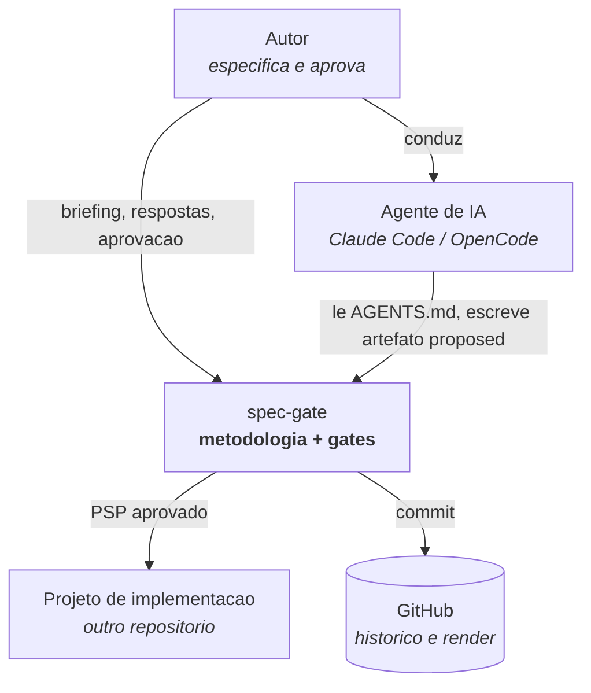
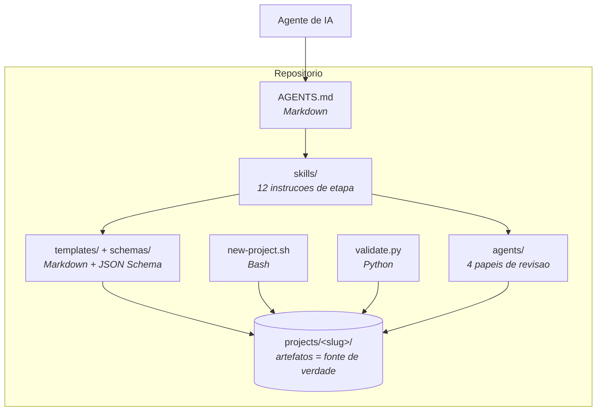

# Arquitetura

> C4 níveis 1 e 2. Nível 3 fora de propósito por ADR-004.

## Nível 1 — Contexto

| Ator ou sistema | Papel | Relação com o produto |
|---|---|---|
| Autor | Única pessoa. Fornece briefing, responde entrevista, aprova etapa | Único que promove a `approved` (BR-001) |
| Agente de IA | Executa o processo: critica, entrevista, gera artefato `proposed` | É a interface; não há outra |
| Projeto de implementação | Consome o PSP e constrói o software | Fora deste repositório, por escopo |
| GitHub | Histórico, hospedagem e renderização de Mermaid | Sem API, sem integração — só git |

## Nível 2 — Contêineres

| Contêiner | Tecnologia | Responsabilidade | Fala com | Protocolo |
|---|---|---|---|---|
| `AGENTS.md` | Markdown | Regras invioláveis e ordem do ciclo. Entrada do agente | agente | leitura |
| `.claude/skills/` | Markdown + frontmatter | Instrução por etapa. Gera artefato | templates, projeto | leitura/escrita |
| `.claude/agents/` | Markdown + frontmatter | Revisão em contexto isolado. Devolve achados | projeto | leitura |
| `templates/` + `schemas/` | Markdown, JSON Schema | Forma do artefato e contrato do frontmatter | projeto | cópia, validação |
| `validate.py` | Python 3.11 + pyyaml + jsonschema | Os 10 gates. Exit code | projeto | leitura, exit code |
| `new-project.sh` | Bash | Estrutura inicial conforme a trilha | templates, projeto | cópia |
| `projects/<slug>/` | Markdown + YAML | **Fonte de verdade.** É o PSP | — | arquivo em git |

Não há servidor, banco, fila nem processo longo. Todo contêiner é arquivo lido sob demanda.

## Atributos de qualidade que moldaram a estrutura

| NFR | Decisão estrutural que ele forçou |
|---|---|
| NFR-001 (crédito) | Gate em Python local, não em prompt. Skill gera no contexto quente; subagente só onde lê muito e devolve pouco (ADR-005) |
| NFR-003 (portabilidade) | Nenhum banco (ADR-001), nenhum servidor (ADR-002), duas dependências |
| NFR-004 (legibilidade por agente) | Um artefato por arquivo, rastreabilidade no frontmatter, Mermaid único (ADR-003) |
| NFR-002 (tempo) | Validação varre a pasta em memória, sem índice nem cache — dezenas de arquivos não justificam nenhum dos dois |

## Decisões

| ADR | Decisão | Alternativa descartada |
|---|---|---|
| ADR-001 | Arquivo como fonte de verdade, sem banco | Banco com Markdown projetado |
| ADR-002 | Sem aplicação web; o agente é a interface | Monólito modular com UI |
| ADR-003 | Mermaid como formato único de diagrama | PlantUML, Structurizr DSL, DBML |
| ADR-004 | C4 até o nível 2 | C4 até o nível 3 |
| ADR-005 | Skill gera, subagente revisa | Subagente para cada etapa |
| ADR-006 | Gate como exit code de script local | Checklist em prompt, revisado por IA |

## Riscos arquiteturais

| Risco | Sinal de que se materializou | Plano B |
|---|---|---|
| Frontmatter divergir do schema conforme os templates evoluem | G8 acusando em projeto que estava verde | Versionar o schema e migrar com script |
| Projeto grande deixar o PSP ilegível para o agente | Agente pedindo o PSP inteiro para executar uma fatia | Índice por fatia, gerado do plano |
| `stale` manual ser esquecido | PSP aprovado com artefato incoerente que o gate não pegou | Propagação automática via `depends_on` (Q-002) |
| Gate virar cerimônia e o autor contorná-lo | Commit desligando gate para "passar" | Nenhum. Se acontecer, o gate estava errado — revisar a regra, não o script |

## O que foi deliberadamente deixado de fora

Cache, índice, banco, servidor, fila, autenticação, CI, container, API. E orquestração
multiagente concorrente: um papel por vez. Ausência documentada aqui para que ninguém
adicione por reflexo — cada item volta à mesa só com um sinal concreto da tabela de riscos.
