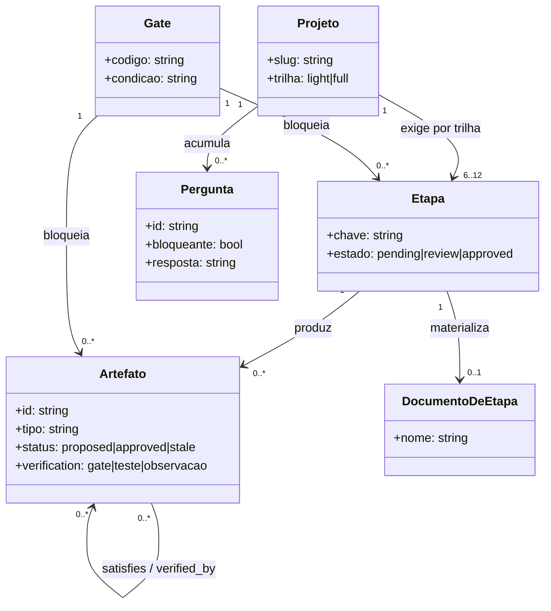

# Modelo de domínio

## Glossário

| Termo | Definição | Não confundir com |
|---|---|---|
| Projeto | Uma especificação em andamento. Uma pasta sob `projects/`, isolada das demais | Implementação — o software construído a partir dela |
| Implementação | O software construído a partir do PSP, em repositório próprio | Projeto, que é a especificação |
| Autor | A única pessoa que usa o spec-gate. Fornece briefing, responde entrevista, aprova etapa | Usuário, que é termo dos projetos especificados |
| Trilha | Conjunto de etapas obrigatórias, proporcional ao porte: `light` ou `full` | Fase — trilha é escopo de exigência, não momento no tempo |
| Etapa | Uma frente de especificação (requisitos, domínio, arquitetura) com estado próprio | Artefato — a etapa produz artefatos, não é um |
| Artefato | Unidade especificada com ID estável e frontmatter rastreável: `FR`, `NFR`, `BR`, `UC`, `ADR`, `TC`, `PR` | Documento de etapa, que não tem ID |
| Documento de etapa | Arquivo narrativo, um por etapa, sem ID e sem frontmatter: briefing, domínio, arquitetura, plano | Artefato, que é citável por ID |
| Template | Forma vazia de um tipo de artefato, com as perguntas que ele precisa responder | Artefato preenchido |
| Gate | Condição objetiva que bloqueia a entrega enquanto violada | Revisão — o gate é mecânico, a revisão é de sentido |
| PSP | Instantâneo imutável do Projeto — um commit ou tag — que passou todos os gates. A entrega | Projeto, que é a pasta viva e continua mudando |
| Lacuna | Informação necessária e ausente | Decisão pendente — a lacuna é falta de informação, não de escolha |
| Pergunta bloqueante | Lacuna cuja ausência de resposta exigiria retrabalho estrutural | Pergunta comum, que não impede a entrega |
| Skill | Instrução de etapa carregada no contexto atual. Gera | Subagente, que paga contexto frio |
| Subagente | Papel de revisão em contexto isolado. Lê muito, devolve pouco | Skill — subagente nunca gera artefato |
| Rastreabilidade | A relação declarada entre artefatos, em ambas as direções | Cobertura — rastreabilidade é o link, cobertura é o link estar completo |

## Entidades e relações

## Invariantes

- Todo `Artefato` pertence a exatamente um `Projeto`. Não há artefato compartilhado entre
  projetos — isolamento é a razão de existir a pasta.
- O `id` do `Artefato` é igual ao nome do arquivo e imutável (BR-005).
- `Artefato.status` só vai a `approved` por ação humana (BR-001).
- `Projeto.trilha` só avança (BR-003).
- Todo `Artefato` tem ID; nenhum `Documento de etapa` tem. É o que os separa, e o que
  decide se uma coisa pode ser citada por outra.
- Todo `FR-*` declara `verification` (G11): `gate` e `teste` são confirmáveis por máquina,
  `observacao` só por humano.
- O `PSP` é imutável. O `Projeto` que o originou continua mudando depois da entrega.
- Toda relação declarada aponta para artefato existente no mesmo projeto — garantido pelo
  gate G3, não pela estrutura de arquivo.
- `Pergunta` com `bloqueante: true` e sem resposta impede o `Projeto` de virar PSP (G5).

## Linguagem proibida

| Não use | Use | Por quê |
|---|---|---|
| exportar | entregar | Não há conversão: a pasta é o pacote |
| banco, tabela, registro | arquivo, artefato | Não há banco neste projeto; o termo confunde com o domínio dos projetos especificados |
| usuário | autor | Uso individual; "usuário" é o termo dos projetos especificados, não deste |
| documentação | especificação | Documentação descreve o que existe; especificação define o que será construído |
| task, card, Kanban | etapa | Não há Kanban; etapa tem estado, não posição em coluna |
| agente | skill ou subagente | A distinção é o que economiza crédito — apagá-la apaga a decisão |
| projeto de implementação | Implementação | `Projeto` é a especificação. Usar a palavra para as duas coisas é a sobrecarga que o glossário existe para impedir |
| in_progress | — | Estado removido: nenhum gate o tratava diferente de `pending` |
| documento (para FR, BR, ADR) | Artefato | Documento de etapa e Artefato são coisas diferentes; o segundo tem ID |
