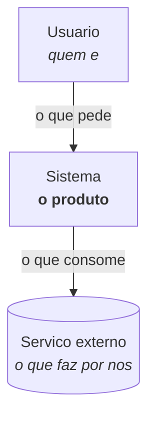
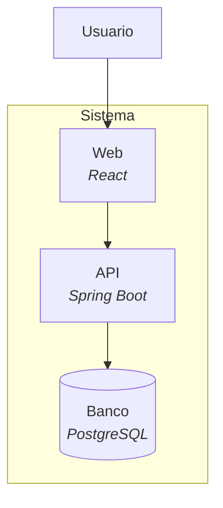

# Arquitetura

> C4 níveis 1 e 2. **Nível 3 (componente) fica fora de propósito:** envelhece em semanas
> e o código conta melhor. Se precisar dele um dia, gere a partir do código, não à mão.

## Nível 1 — Contexto

O sistema e quem fala com ele. Nenhum detalhe interno.

| Ator ou sistema | Papel | Relação com o produto |
|---|---|---|

## Nível 2 — Contêineres

Unidades executáveis ou de armazenamento, e a tecnologia de cada uma.

| Contêiner | Tecnologia | Responsabilidade | Fala com | Protocolo |
|---|---|---|---|---|

Contêiner sem responsabilidade distinta dos vizinhos é contêiner a menos.

## Atributos de qualidade que moldaram a estrutura

| NFR | Decisão estrutural que ele forçou |
|---|---|

Arquitetura sem NFR por trás é gosto pessoal. Se nenhuma linha preenche, a estrutura foi
escolhida por hábito — vale revisar.

## Decisões
Cada decisão relevante é um `decisions/ADR-*.md`. Esta tabela só indexa.

| ADR | Decisão | Alternativa descartada |
|---|---|---|

## Riscos arquiteturais

| Risco | Sinal de que se materializou | Plano B |
|---|---|---|

## O que foi deliberadamente deixado de fora
Cache, fila, réplica, microsserviço, feature flag. O que não existe e por que não precisa
existir ainda — para que ninguém adicione por reflexo.
