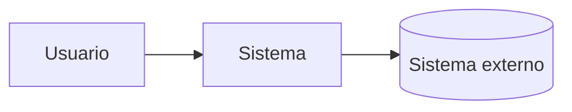

# Arquitetura

## Contexto
O sistema e o que existe em volta dele.

## Componentes internos
| Componente | Responsabilidade | Depende de |
|---|---|---|

## Decisões
Cada decisão relevante é um `decisions/ADR-*.md`. Esta tabela só indexa.

| ADR | Decisão |
|---|---|

## Atributos de qualidade que moldaram a arquitetura
Qual `NFR-*` forçou qual escolha estrutural. Arquitetura sem NFR por trás é gosto pessoal.

## Riscos arquiteturais
O que pode se provar errado, e qual sinal indicaria isso.
