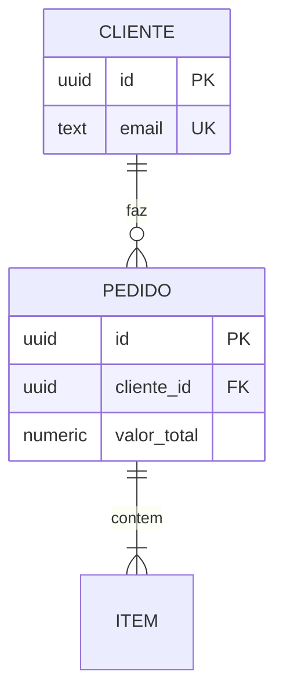

# Modelo de dados

> O diagrama mostra a estrutura. A tabela carrega o que o diagrama não expressa: tipo,
> constraint, índice, e por que o índice existe.

## Diagrama

## Tabelas

### `nome_da_tabela`
Para que serve, em uma linha. Qual entidade do domínio representa (`domain-model.md`).

| Coluna | Tipo | Nulo | Constraint | Observação |
|---|---|:-:|---|---|
| `id` | uuid | não | PK | |
| `criado_em` | timestamptz | não | default now() | |

**Índices:** nome, colunas, e **qual consulta o justifica**. Índice sem consulta por trás
é custo de escrita sem retorno.

**Deleção:** cascata, restrição ou lógica. Diga qual, e o que acontece com o filho.

## Decisões de modelagem
Denormalização, escolha de tipo, particionamento, soft delete. Cada uma com o `ADR-*`
quando a decisão for relevante. Dado existente que precisa migrar entra aqui.

## Invariantes garantidas pelo banco
Quais regras (`BR-*`) a estrutura garante sozinha, e quais dependem de código. Regra que
só o código garante é regra que alguém vai furar.
