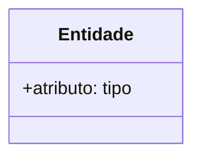

# Modelo de domínio

## Glossário
Termo do domínio, na palavra que o usuário usa. Um termo, um significado, em todo o PSP.

| Termo | Definição | Não confundir com |
|---|---|---|

## Entidades e relações

## Invariantes
Regra que a estrutura garante sempre, independente do fluxo. Cite o `BR-*` quando houver.

## Linguagem proibida
Termo ambíguo ou herdado que não deve aparecer no código nem na documentação, e o que
usar em vez dele.

| Não use | Use |
|---|---|
