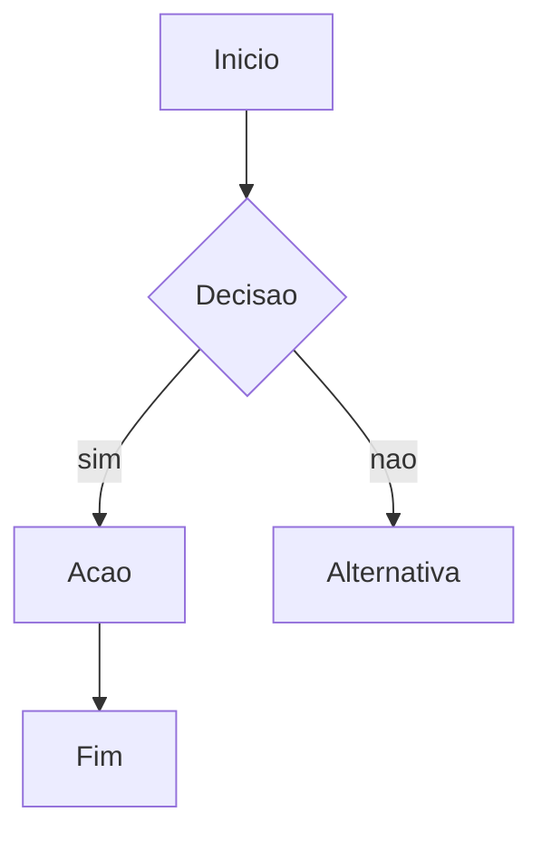
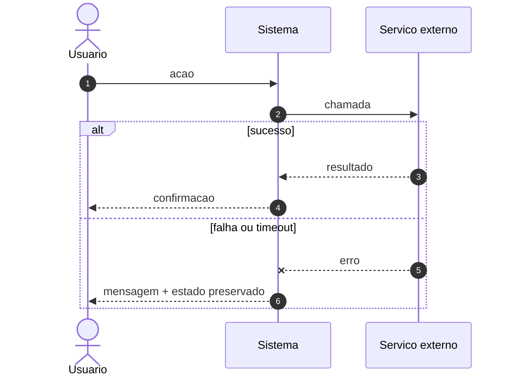

# PR-001 — Nome do fluxo

**Ator:** · **Gatilho:** · **Resultado:**

## Fluxo

<!-- Gate G10: flowchart mermaid obrigatorio neste artefato. -->

| Passo | Regra aplicada | Requisito |
|---|---|---|
| B | BR-001 | FR-001 |

## Exceções
O que acontece quando falha, quem é avisado, o que acontece com o dado pela metade.

## Sequência

Só se este fluxo for **crítico**: integração externa, ordem que importa, estado
intermediário, ou falha parcial possível. Sequência de CRUD é desperdício — sem resposta
para "por que este fluxo é crítico", apague esta seção.

| Passo | Pode falhar? | Consequência | Tratamento |
|---|:-:|---|---|
| 2 | sim | | |

Todo caminho de falha do diagrama precisa de linha na tabela. Sequência que só mostra o
caminho feliz não serve para implementar.
