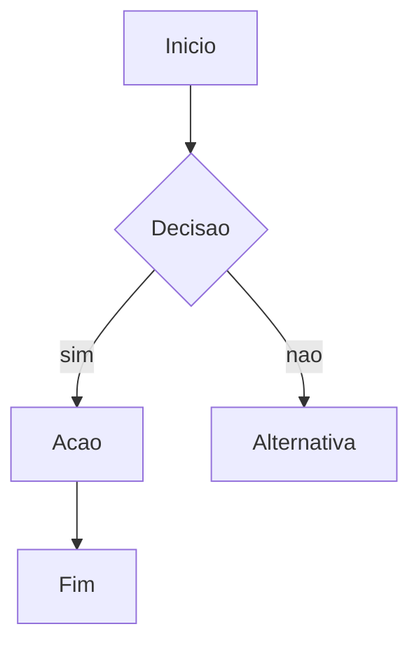

# Fluxos e processos

> Um diagrama por fluxo relevante. Prosa só para a exceção que o diagrama não expressa.

## PR-001 — <nome do fluxo>

**Ator:** · **Gatilho:** · **Resultado:**

| Passo | Regra aplicada | Requisito |
|---|---|---|
| B | BR-001 | FR-001 |

**Exceções:** o que acontece quando falha, quem é avisado, o que acontece com o dado
pela metade.
