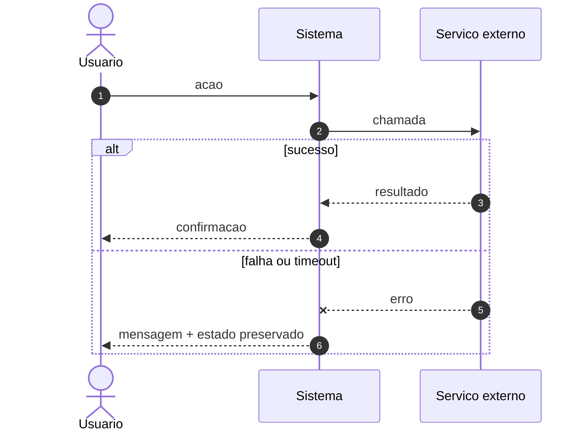

# Diagramas de sequência

> Só para **fluxo crítico**: onde há integração externa, ordem que importa, estado
> intermediário, ou falha parcial possível. Sequência de CRUD é desperdício.

## SQ-001 — <o que esta sequencia mostra>

**Por que este fluxo é crítico:** uma linha. Se não houver resposta, apague o diagrama.

| Passo | Pode falhar? | Consequência | Tratamento |
|---|:-:|---|---|
| 2 | sim | | |

Todo caminho de falha do diagrama precisa de linha na tabela. Sequência que só mostra o
caminho feliz não serve para implementar.
